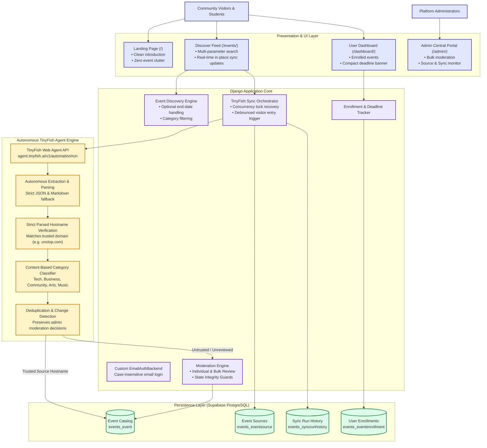
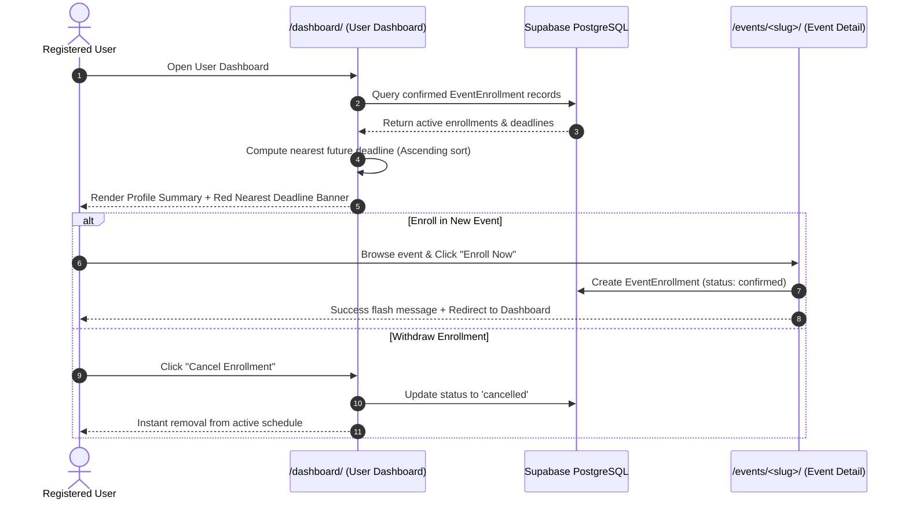
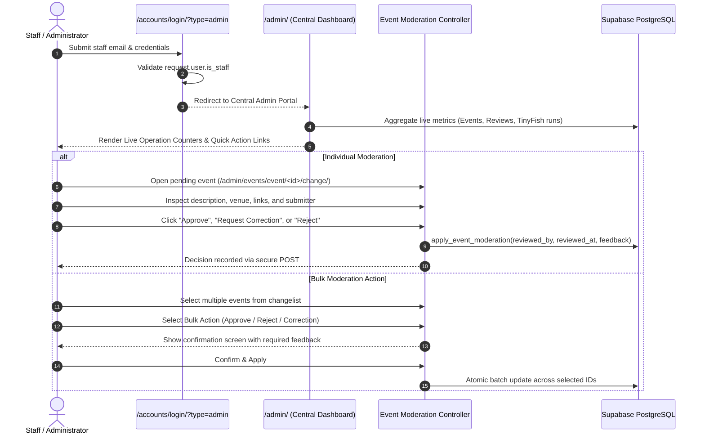
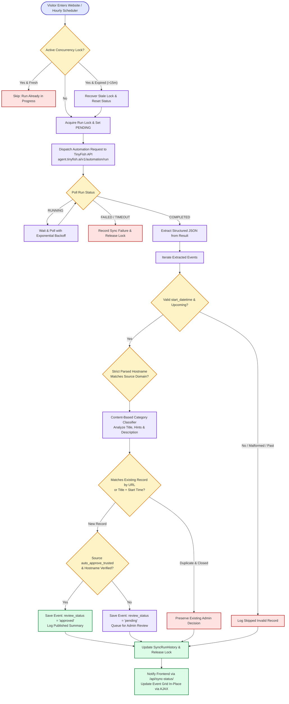

# Vibento

> **“Discover nearby events. Connect with your community.”**

Vibento is a production-grade, hyperlocal event discovery, community engagement, and autonomous aggregation platform built with **Python 3.14**, **Django 6.1**, and hosted **Supabase PostgreSQL**. It seamlessly connects community members—students, developers, working professionals, founders, and creators—with local gatherings, hackathons, tech meetups, cultural workshops, and student competitions.

Vibento features a multi-tiered architecture combining a clean user introduction portal, interactive event catalog with real-time in-place updates, personalized user deadline tracking, organizer submission portals, an administrative central moderation suite, and autonomous background event extraction powered by **TinyFish Web Agents**.

---

## Architecture & System Overview

Vibento is designed around modular, decoupled workflows that balance community submissions, administrator trust policies, and autonomous web-agent synchronization:



---

## 1. Core Platform Capabilities

### A. Clean Landing Page & Authentication
- **Introduction Portal (`/`):** A distraction-free landing page introducing the platform's mission, autonomous TinyFish features, and clear onboarding pathways without displaying premature event cards or personal dashboard widgets.
- **Secure Authentication Flow:**
  - Case-insensitive email and password authentication powered by `accounts.backends.EmailAuthBackend`.
  - Seamless logout destination: logging out flushes sessions and redirects to the intro page (`/`), immediately presenting logged-out navbar controls (**Log In** / **Sign Up**).
  - Protected dashboard routes enforce `@login_required`, immediately redirecting unauthenticated visitors to login.
  - Multi-step registration wizard (`/accounts/signup/`) spanning email, age validation, community persona (*Student*, *Professional*, *Founder*, *Hobbyist*), location, and server-side validated credentials.
  - Topic preferences selection (`/accounts/interests/`) with interactive topic chips (*Technology & AI, Startups & Business, Live Music, Arts & Crafts, Books, Community & Social*).

### B. Public Event Discovery & Real-Time In-Place Feed (`/events/`)
- **Comprehensive Discovery Catalog:** Browses only verified, approved, upcoming community events, hackathons, and competitions.
- **Multi-Parameter Search & Filtering:** Filter by keyword query, category slug, target city, locality/area, pricing (free vs. paid), and time windows (*Today, Tomorrow, This Weekend, This Week, This Month*, or custom date ranges).
- **Robust Handling of Optional End Dates:**
  - Events with `end_datetime = None` remain completely visible throughout their event day and across all date-range filters rather than disappearing mid-day.
- **Infinite-Loop-Proof In-Place Feed Updates:**
  - When background TinyFish imports publish new events, the client fetches updated HTML fragments via asynchronous `X-Requested-With: XMLHttpRequest` calls and updates the `#events-grid-container` in place.
  - Eliminates full page reloads, preventing circular synchronization loops while preserving genuine user page reloads.

---

## 2. Dashboard Working & Workflows

### User Dashboard Workflow (`/dashboard/`)



The **User Dashboard** provides personalized schedule tracking:
1. **Compact Nearest Deadline Banner:** Displays a high-visibility, urgency-styled reminder for the closest upcoming registration or submission cutoff:
   $$\text{Remaining Time} = \text{Registration Deadline} - \text{Current Timestamp}$$
   *(Formatted cleanly into readable days, hours, and minutes; passed deadlines are never displayed).*
2. **Profile & Preferences:** Quick glance at city, locality, user persona, and selected interest tags.
3. **Active Enrollments List:** Comprehensive cards for all confirmed events, showing date, venue, category, and direct external registration links.
4. **Deadline Ledger:** Detailed breakdown of upcoming registration cutoffs, submission milestones, and application dates.

---

### Central Admin Moderation Dashboard Workflow (`/admin/`)



The **Central Admin Dashboard** provides full operational control:
- **Live Metric Badges:** Total events, pending moderation queue count, approved listings, WhatsApp intakes, configured sources, and active TinyFish worker runs.
- **Granular Moderation Controls:** Dedicated green (*Approve*), amber (*Needs Correction*), and rose (*Reject*) buttons with mandatory feedback for corrections/rejections.
- **Bulk Action Intermediary:** Confirmation workflow for multi-event batch approvals.
- **Source Sync Monitor:** Quick access to configured sources, recent sync run logs, error traces, and synchronization controls.

---

## 3. Autonomous TinyFish Web Agent Engine

Vibento integrates with the **TinyFish Web Agent API** (`agent.tinyfish.ai`) to autonomously discover, extract, validate, deduplicate, and publish event listings from curated sources (e.g., Unstop, community feeds).

### Autonomous Pipeline Flowchart



---

### Core Safeguards in TinyFish Engine

| Safeguard | Implementation Details |
| :--- | :--- |
| **Strict Hostname Trust Verification** | Validates the original source URL via `urllib.parse.urlparse(original_url).hostname`. Auto-publication only occurs if the event hostname strictly matches the configured trusted domain (e.g. `unstop.com` or `*.unstop.com`). Spoofed or lookalike domains are automatically routed to the pending queue. |
| **Content-Based Category Classification** | Rather than forcing generic competitions into *Technology*, `match_category` analyzes real event subject matter: economic/portfolio simulations become *Startups & Business*; escape rooms and quizzes become *Community & Social*; coding challenges and hackathons become *Technology & AI*. Uncertain events fall back safely to *Community & Social*. |
| **Preservation of Missing Attributes** | Unknown or missing optional fields (end dates, venue addresses, ticket prices) remain honestly `null` / `None`. Vibento never fabricates dates, venues, or cities. |
| **Admin Decision Integrity** | Deduplication verifies normalized URLs and titles. If an event was previously reviewed, rejected, or edited by an admin, background sync runs will **never** overwrite or revert the administrator's decision. |
| **Deadlock & Timeout Recovery** | If a network glitch or process termination leaves an active sync lock hanging, worker triggers automatically detect expired locks (>15 minutes) and recover them safely. |

---

## 4. Technology Stack & Dependencies

```
Python 3.14.7  |  Django 6.1.2  |  Supabase PostgreSQL  |  Psycopg 3.3.6  |  Bootstrap 5.3.3
```

- **Backend Framework:** Python `3.14.7` and Django `6.1.2`
- **Database Engine:** Hosted PostgreSQL on **Supabase** via Django ORM
  - Driver: `psycopg` `3.3.6` (with `psycopg-binary`)
  - Connection Config: `dj-database-url` `2.3.0`
- **External Web Automation:** TinyFish Agent API (`https://agent.tinyfish.ai/v1/automation/run`)
- **Frontend Architecture:**
  - Semantic HTML5 & Django Template Language
  - Styling: Bootstrap `5.3.3` + Bootstrap Icons `1.11.3` + Custom Design Tokens (`custom.css`)
  - Client Interactions: Vanilla JavaScript (Asynchronous Fetch, DOMParser, debounced polling)
- **Image Processing:** `Pillow` `13.0.0`
- **Configuration:** `python-dotenv` `1.1.1`

---

## 5. Local Setup & Execution Guide

Follow these steps to run Vibento locally on Windows PowerShell:

### 1. Clone & Enter Project Directory
```powershell
git clone https://github.com/itsLUNEXA/vibentoLOOPHOLES-SHIVAM.git
cd vibentoLOOPHOLES-SHIVAM
```

### 2. Set Up Virtual Environment & Dependencies
```powershell
python -m venv .venv
.\.venv\Scripts\Activate.ps1
pip install -r requirements.txt
```

### 3. Configure Environment Variables
Copy `.env.example` to create your local `.env`:
```powershell
copy .env.example .env
```
Ensure your `.env` contains the required keys:
```env
SECRET_KEY=your-secure-secret-key
DEBUG=True
ALLOWED_HOSTS=localhost,127.0.0.1,testserver
TIME_ZONE=Asia/Kolkata

# Remote Supabase Connection Pooler (Port 5432)
DATABASE_URL=postgresql://postgres.<project-ref>:<db-password>@<pooler-host>.pooler.supabase.com:5432/postgres

# TinyFish Agent Configuration
TINYFISH_API_KEY=your-tinyfish-api-key
TINYFISH_ALLOWED_SOURCES=https://unstop.com/,https://example-events.org/
```

### 4. Run the Automated Launcher
```powershell
python start.py
```
*`start.py` performs automated pre-flight checks: validates dependencies, verifies Supabase database connectivity, ensures schema migrations are applied, and launches the development server at `http://127.0.0.1:8000/`.*

---

## 6. Project Structure

```text
e:\veck\
├── accounts/                  # Authentication & Profile Subsystem
│   ├── admin.py               # Custom User & Profile admin settings
│   ├── backends.py            # Case-insensitive EmailAuthBackend
│   ├── forms.py               # Signup forms, InterestsForm, ProfileForm
│   ├── models.py              # UserProfile model (interests, user_type, city)
│   ├── tests.py               # Authentication, wizard, and logout regression tests
│   ├── urls.py                # Accounts routing (/accounts/*)
│   └── views.py               # Login, multi-step signup, interests, profile
├── config/                    # Core Configuration
│   ├── settings.py            # Django settings, Supabase config, TinyFish settings
│   ├── urls.py                # Root routing, customized admin branding & hooks
│   └── wsgi.py                # WSGI application entry
├── events/                    # Event Management & Autonomous TinyFish Subsystem
│   ├── admin.py               # EventAdmin, EventSourceAdmin, SyncRunHistoryAdmin, Moderation actions
│   ├── forms.py               # EventForm, WhatsAppSubmissionForm
│   ├── models.py              # Category, Event, EventSource, SyncRunHistory, EventEnrollment
│   ├── services.py            # Background refresh coordinator, concurrency lock engine, sync APIs
│   ├── tests.py               # 80-test regression suite covering discovery, sync, and filters
│   ├── tinyfish.py            # TinyFish client, hostname validation, content category matching
│   ├── urls.py                # Public discovery, dashboards, enrollment, sync API endpoints
│   └── views.py               # Landing page, discovery feed, user/organizer dashboards
├── static/css/                # Custom design system tokens and component styles
│   ├── custom.css             # Responsive breakpoints, custom cards, hero banners, badges
│   └── theme.css              # Curated color tokens (indigo, violet, slate)
├── templates/                 # Server-rendered Template Hierarchy
│   ├── base.html              # Core HTML wrapper with responsive navbar and footer
│   ├── navbar.html            # Dynamic navbar (User vs Anonymous vs Staff navigation)
│   ├── landing.html           # Introduction landing page (zero event clutter)
│   ├── accounts/              # Multi-step signup wizard and dual-mode login templates
│   ├── admin/                 # Central admin index, moderation forms, and sync monitors
│   └── events/                # Discovery feed, user dashboard, organizer dashboard, event details
├── manage.py                  # Django CLI entry point
├── requirements.txt           # Verified Python package dependencies
├── start.py                   # Automated development launcher with pre-flight checks
└── README.md                  # Project documentation & visual architecture guide
```

---

## 7. Verification & Automated Testing

Vibento includes an automated regression test suite covering authentication, moderation, discovery filters, and TinyFish integration:

```powershell
.\.venv\Scripts\python.exe manage.py test
```

### Verified Test Suite Results
```text
Creating test database for alias 'default'...
................................................................................
----------------------------------------------------------------------
Ran 80 tests in 62.979s

OK
Destroying test database for alias 'default'...
Found 80 test(s).
System check identified no issues (0 silenced).
```

### Key Regression Assertions Verified
1. **Loop Prevention:** Confirms in-place completion updates with `X-Requested-With: XMLHttpRequest` never trigger background sync runs, preventing refresh loops.
2. **Category Classification Accuracy:** Confirms domain keywords accurately categorize events into *Startups & Business*, *Technology & AI*, and *Community & Social* without inventing evidence.
3. **Optional End-Date Visibility:** Confirms events with `end_datetime = None` remain visible in general listings and date filters (*Today*, *Tomorrow*, *This Week*).
4. **Logout Destination:** Confirms POST logout terminates sessions and opens the clean landing page (`/`) with logged-out navbar controls.
5. **Admin Decision Protection:** Confirms existing administrative rejections or edits are never overridden by background imports.
6. **External API Mocking:** All automated tests mock external network requests via `unittest.mock.patch`, executing safely and deterministically without live or paid API usage.

---

## 8. License & Attribution

Vibento is developed as an open community discovery platform. All event data imported from external sources displays transparent source attribution and check timestamps linking directly to organizers' official websites.
